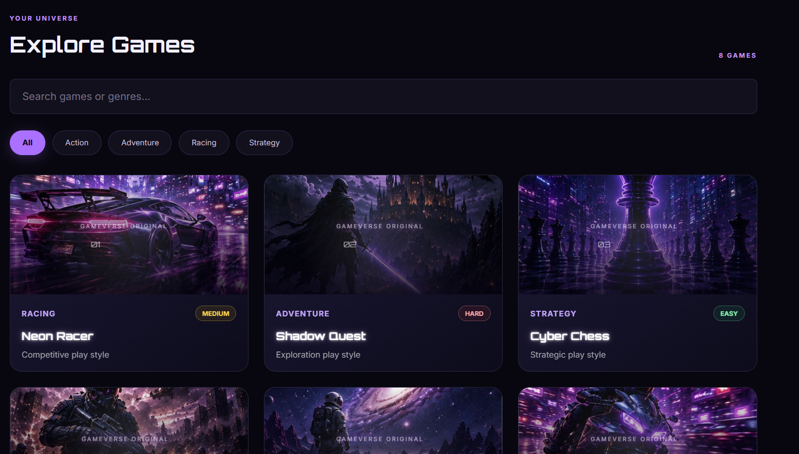
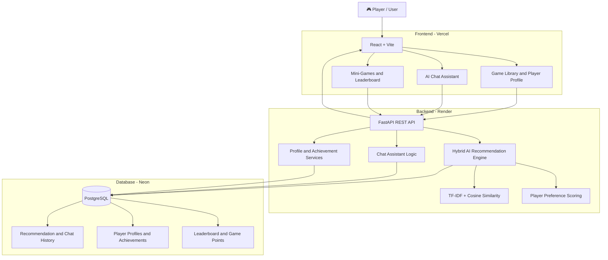

# 🎮 GameVerse AI

<p align="center">
  
  
  
  
</p>

<p align="center">
  <a href="https://game-verse-ai.vercel.app/">
    
  </a>
  <a href="https://github.com/amyie567/GameVerse-AI">
    
  </a>
</p>

### AI-Powered Game Recommendation Platform

**Live Website:** https://game-verse-ai.vercel.app/

## 📌 About

GameVerse AI is a full-stack gaming platform that helps players discover games based on their interests and preferences.

It uses a hybrid recommendation engine combining machine learning techniques and preference-based scoring to provide personalized game suggestions.

The platform also includes an AI chat assistant, player profiles, achievements, leaderboards, and interactive mini-games.

## ✨ Features

\- 🤖 Hybrid AI game recommendation system

\- 🎯 Personalized recommendations based on genre, difficulty, and play style

\- 💬 Interactive gaming chat assistant

\- 👤 Player profiles and preference management

\- 🏆 Achievements and leaderboard

\- 🧠 Memory Match mini-game

\- ⚡ Reaction Time mini-game

\- 📚 Recommendation history

\- 💾 PostgreSQL database integration

\- 🎨 Responsive futuristic gaming interface

\- 🖼️ Cinematic artwork for eight games

## 🛠️ Technology Stack

| Category | Technology |

|---|---|

| Frontend | React, Vite, JavaScript, CSS |

| Backend | Python, FastAPI |

| Machine Learning | Scikit-learn |

| ML Techniques | TF-IDF, Cosine Similarity |

| Database | PostgreSQL, Neon |

| Backend Testing | Pytest |

| Frontend Testing | Vitest |

| Code Quality | Ruff, Oxlint |

| Frontend Hosting | Vercel |

| Backend Hosting | Render |

## 🧠 AI Recommendation Engine

GameVerse AI uses a hybrid recommendation algorithm.

\*\*How it works:\*\*

1\. TF-IDF converts game information into numerical vectors.

2\. Cosine similarity measures how closely games match player preferences.

3\. Preference scoring evaluates genre, difficulty, and play style.

4\. Both scores are combined to rank the recommended games.

\*\*Hybrid scoring:\*\*

\- 60% content similarity

\- 40% preference matching

This approach combines content-based similarity with player preference matching.

## 🎮 Game Collection

| Game | Genre |

|---|---|

| Neon Racer | Racing |

| Shadow Quest | Adventure |

| Cyber Chess | Strategy |

| Battle Zone | Action |

| Galaxy Explorer | Adventure |

| Speed Legends | Racing |

| Shadow Strike | Action |

| Kingdom Tactics | Strategy |

## 🏗️ Project Structure

```text

GameVerse-AI/

│

├── backend/

│   ├── main.py

│   ├── database.py

│   └── requirements.txt

│

├── frontend/

│   ├── public/

│   │   └── images/

│   │       └── games/

│   ├── src/

│   │   ├── App.jsx

│   │   ├── App.css

│   │   └── components/

│   └── package.json

│

└── README.md

```

## 💻 Run Locally

### 1. Clone the repository

```bash

git clone https://github.com/amyie567/GameVerse-AI.git

cd GameVerse-AI

```

### 2. Backend setup

```powershell

cd backend

python -m venv venv

.\\venv\\Scripts\\Activate.ps1

pip install -r requirements.txt

```

Configure the required database connection and environment variables. Never commit passwords or API secrets.

Start the backend:

```powershell

python -m uvicorn main:app --reload

```

Backend: http://127.0.0.1:8000

API documentation: http://127.0.0.1:8000/docs

### 3. Frontend setup

Open another terminal:

```powershell

cd frontend

npm install

npm run dev

```

Open the local URL displayed by Vite.

## ☁️ Deployment

| Service | Platform |

|---|---|

| Frontend | Vercel |

| Backend | Render |

| PostgreSQL Database | Neon |

## 🎯 What This Project Demonstrates

\- Full-stack web application development

\- REST API development with FastAPI

\- Machine learning fundamentals

\- Hybrid recommendation algorithms

\- Relational database integration

\- Frontend and backend integration

\- Automated testing and code quality

\- Cloud deployment

\- Responsive user interface development

## 👨‍💻 Author

Built as a hands-on portfolio project focused on \*\*AI Engineering and Full Stack Development\*\*.

\---

⭐ If you find GameVerse AI interesting, consider starring the repository!

## Project Screenshots

### Explore Games



## 🏗️ System Architecture

GameVerse AI uses a full-stack architecture connecting a React frontend, FastAPI backend, hybrid AI recommendation engine, and PostgreSQL database.



### Architecture Components

| Component        | Technology                 |
| ---------------- | -------------------------- |
| Frontend         | React + Vite               |
| Backend          | Python + FastAPI           |
| AI Engine        | TF-IDF + Cosine Similarity |
| Database         | PostgreSQL                 |
| Database Hosting | Neon                       |
| Backend Hosting  | Render                     |
| Frontend Hosting | Vercel                     |
